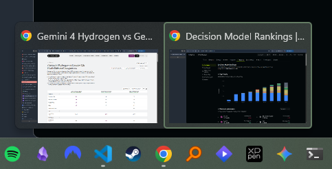

# Taskbar Active Window Highlight

A [Windhawk](https://windhawk.net/) mod for Windows 11. When an app has several
windows open, its taskbar thumbnail preview shows no sign of which one is
active. This mod adds an accent-colored highlight to the active window's card.



The taskbar button keeps Windows' own active indicator; only the preview cards
are changed.

## Install

**From Windhawk** (once the mod is in the catalog): search for
*Taskbar Active Window Highlight* and click **Install**.

**Manually:** in Windhawk, click **Create a New Mod**, replace the template
with the contents of
[`taskbar-active-window-highlight.wh.cpp`](taskbar-active-window-highlight.wh.cpp),
then click **Compile Mod**.

## Settings

| Setting | Default | |
|---|---|---|
| Highlight color | Windows accent color | Or a hex color such as `#3A96DD` |
| Fill opacity | 20 | 0–100 |
| Outline thickness | 2 px | 0 for no outline |
| Keep the highlight while using the taskbar | On | See below |

Clicking the taskbar or a preview list briefly gives focus to the taskbar
itself, and Windows then reports no active window. With the last setting on,
the window you came from stays highlighted until another window or the desktop
takes focus, or the window is minimized or closed.

## How it differs from Taskbar Recent Focus Highlight

[Taskbar Recent Focus Highlight](https://windhawk.net/mods/taskbar-recent-focus-highlight)
also marks a window in the thumbnail preview, but it answers a different
question: which windows of this app were used most recently. It keeps its own
focus history, with minimum-focus and decay timers, on a background thread.

This mod shows only which window is active right now, using Explorer's own
active task item, with no focus tracking, threads or timers. In practice:

- While another app has focus, this mod marks nothing in this app's preview;
  Recent Focus Highlight still marks its last-used window.
- This mod also marks single-window previews; Recent Focus Highlight skips them.
- This mod changes only the previews; Recent Focus Highlight's main feature is
  highlighting taskbar icons.

## How it works

The mod does not track focus or poll anything. It reads two things Explorer
already keeps:

- **The active window.** Explorer's taskbar view (`Taskbar.View.dll`) handles
  an `ActiveItemChanged` notification from its task list. The mod hooks that
  handler and reads `TaskbarAppsList.ActiveItem.WindowId`, Explorer's own
  record of the active window.
- **Each card's window.** A thumbnail card's view model leads to its task item:
  `ThumbnailSource → TaskItemThumbnail → ParentItem → WindowId`.

When a card is created, bound to a window, or the active window changes, the
mod compares the two and shows or hides one extra element on the card. That
element sits directly above the card's own background (`BackgroundBorder`) and
below its title, icon and preview image. Its size and corner radius are bound
to that background, so it follows themes such as Windows 11 Taskbar Styler.
The element registers no event handlers, so nothing can call into the mod
after it is disabled; on unload the elements are removed.

Interfaces are reached with `QueryInterface` by IID rather than by memory
offsets. The `WindowsUdk.UI.Shell` IIDs and method order come from the
system's `windowsudk.winmd`; the internal `Taskbar.*` IIDs come from the
`guid_v` constants in Microsoft's public symbols for `Taskbar.View.dll`. If a
Windows update changes one of these interfaces, its IID changes, the query
fails, and the mod simply shows no highlight.

## Performance and footprint

The taskbar is critical UI, so the mod is built to stay out of its way:

- **Event-driven only.** No background thread, timers, polling, or focus
  tracking of its own. Mod code runs only when Explorer reports a new active
  window or binds a preview card to a window.
- **Nothing on hover or layout.** Moving the mouse over the taskbar or the
  previews runs no mod code at all.
- **Reuses Explorer's state.** The active window and each card's window come
  from Explorer's own model, so there is no second source of truth to drift
  out of sync, and no cache to invalidate.
- **One element per card**, created once and then only shown or hidden. Its
  geometry follows the card through XAML bindings, so no resize or relayout
  handling is needed.
- **Clean to unload.** No event handlers or callbacks stay registered in
  Explorer, so disabling the mod cannot leave its code reachable.

Measured with a timing build on Windows 11 26H2 (build 26300.9974), in normal
use (window switching and opening multi-window previews):

| Hook (when it runs) | Calls | Mod, typical | Mod, worst | Explorer's own handler, typical |
|---|---|---|---|---|
| Active window changed | 81 | 0.004 ms | 0.67 ms | 0.08 ms |
| Card bound to a window | 43 | 0.004 ms | 0.09 ms | <0.001 ms |
| Card template applied | 41 | 0.013 ms | 0.51 ms | 0.14 ms |

The worst cases are the first time a card's highlight element is created and
window switches that update open cards; all stay under 1 ms, against a 16.7 ms
frame at 60 Hz. Nothing runs on hover, layout or timers.

## Compatibility

Requires the Windows 11 taskbar's XAML thumbnail previews
(`TaskItemThumbnailView` in `Taskbar.View.dll`). Tested on Windows 11 26H2,
build 26300.9974 (`Taskbar.View.dll` 2609.12001.100.0), with and without
Windows 11 Taskbar Styler.

With the classic thumbnails, the Windows 10 taskbar, or taskbar replacements
such as StartAllBack or ExplorerPatcher, the mod has no effect.

## Development

- [`tools/build.sh`](tools/build.sh) compiles a mod with Windhawk's bundled
  compiler and flags, to catch errors before installing it in Windhawk.
- [`probe/taskbar-active-probe.wh.cpp`](probe/taskbar-active-probe.wh.cpp) is
  the diagnostic mod used to verify the interfaces on a live Explorer. It
  changes nothing on screen and logs to `%TEMP%\taskbar-active-probe.log`.
- [`tools/getpdb.py`](tools/getpdb.py), [`tools/syms.py`](tools/syms.py) and
  [`tools/pdbguids.py`](tools/pdbguids.py) download a DLL's public symbols,
  list its undecorated symbol names, and read interface IID constants from it.
  Use them to re-check the IIDs and symbol names after a Windows update, for
  example:

  ```sh
  python tools/getpdb.py "C:/Windows/SystemApps/MicrosoftWindows.Client.Core_cw5n1h2txyewy/Taskbar.View.dll" .
  python tools/pdbguids.py Taskbar.View.pdb "C:/Windows/SystemApps/MicrosoftWindows.Client.Core_cw5n1h2txyewy/Taskbar.View.dll" "guid_v<struct winrt::Taskbar::ITaskItemThumbnailView"
  ```

  The `WindowsUdk.UI.Shell` declarations can be regenerated with the Windows
  SDK's `winmdidl.exe` from
  `C:\Windows\SystemApps\MicrosoftWindows.UndockedDevKit_cw5n1h2txyewy\windowsudk.winmd`.

## License

[GPL-3.0](LICENSE).
